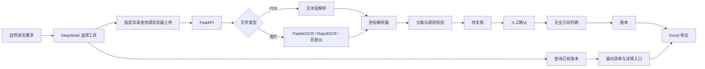

# Invoice Agent · 企业智能票据记账助手

<div align="center">


**用自然语言交代发票任务，本地查找与识别，人工复核后入账，按需导出 Excel。**

支持独立使用的本地规则模式，以及可选的 DeepSeek 对话助手。
使用本地 OCR 时原票留在本机；启用 DeepSeek 后，对话、筛选条件和必要的任务汇总会发送至模型服务。云端 OCR 的文件发送范围见下文。

</div>

<p align="center">
  
  
</p>

<p align="center">
  
</p>

## 项目简介

这是一个面向小微企业、代账人员和个人票据管理的本地工具。DeepSeek 理解任务并调用受限工具，OCR 提取票面，程序负责金额校验、重复检测和导出，使用者负责最终确认入账。

本文介绍已发布的 **V1.0.1** 功能。仓库地址：[1986064872/invoice-agent](https://github.com/1986064872/invoice-agent)，代码检查点：[V1.0.1](https://github.com/1986064872/invoice-agent/tree/V1.0.1)。

```text
指定文件夹或上传 -> 识别与规则校验 -> 待审核台账 -> 人工确认入账
自然语言查询已有账本 -> 展示清单 -> 生成 Excel 下载卡片
```

设计原则：

- OCR 负责把票面变成结构化字段。
- 大模型负责理解要求、延续对话、选择工具和解释结果，不替代确定性校验。
- 规则负责金额、票号、重复票等确定性校验。
- 人工负责最终确认，不承诺“无人审核自动入账”。
- 真实票据、数据库和导出文件默认留在本机。

## 核心能力

| 能力 | 说明 |
|---|---|
| DeepSeek 对话助手 | 支持多轮修改整理条件、启动本地整理、查询账本、查看进度和生成 Excel 下载卡片 |
| 本地文件查找 | 使用用户提供的文件夹路径，递归查找 PDF 和图片；缺少位置时先询问，原文件保持不变 |
| 灵活日期范围 | 本地整理支持单月、非连续多个月份、全年、跨月跨年区间或不限日期 |
| 对话恢复 | 返回 Agent 工作台或刷新页面时恢复当前会话、计划和结果卡片，未发送输入在当前标签会话内保留 |
| 详情直达账本 | 查询清单每行的“详情”可定位正确页码、勾选目标发票、展开明细并滚动到对应位置 |
| 批量上传 | 支持 PDF、JPG、JPEG、PNG，单批最多 50 个文件 |
| PDF 文本层解析 | 直接从电子发票文本层提取坐标，速度快、不联网 |
| 图片 OCR | 可选 PaddleOCR GPU，也可接入 RapidOCR 或百度云 OCR |
| 坐标版面解析 | 按表头坐标划分名称、规格、单位、数量、单价、金额和税额列 |
| 规则校验 | 金额勾稽、必填字段、票号格式、重复票和低置信度提醒 |
| 人工复核 | 左右分栏查看原票与识别字段，修改结果实时重算风险 |
| 企业档案 | 保存当前企业名称、税号和别名，用于判断票据相对企业的方向 |
| 进销项判断 | 税号优先、名称/别名兜底，购买方匹配为进项，销售方匹配为销项 |
| 重复识别 | 用号码、日期、金额和销方税号生成业务指纹，不依赖文件哈希 |
| 分类规则 | 关键词规则自动分类，也可把人工修改沉淀为自定义规则 |
| 账本管理 | 按日期、状态、分类和关键词筛选；关键词覆盖会计科目、项目名称、票面备注、购销方、票号及文件名 |
| 方向筛选 | 账本可按进项、销项和待判断筛选，并显示往来单位 |
| Excel 导出 | 按进销项拆分工作表，按明细行展开，包含购销双方、往来单位和金额字段 |
| 回收站 | 删除票据时移入 `data/trash/`，避免误删原票 |

## 工作流程



**这里有意不做全自动入账。** 发票识别存在 OCR 误差，金额和税号一旦识别错误，自动入账比多一步复核更危险。V1 的目标是把重复操作压缩掉，同时把最终确认权留给使用者。

**导出不等于入账。** “导出当前账本”默认包含全部日期和状态，并显示待复核数量；只需要已确认数据时，请明确说“只导出已入账票据”。

## Agent 怎么用

1. 启动应用，进入侧栏 **Agent 工作台**，或访问 `http://127.0.0.1:8000/agent`。
2. 展开 **DeepSeek API 配置**，在本机填写 API Key，核对模型名称，阅读数据发送说明后启用、保存并测试连接。V1.0.1 默认模型名为 `deepseek-flash`；是否可用以服务商和账号实际支持为准。
3. 直接描述任务。需要查找新文件时提供完整文件夹路径；只查询已有账本时无需提供文件位置。
4. 查看生成的清单，点击“详情”进入账本定位并展开原有明细；需要修正票面信息时使用复核工作台。
5. 人工确认入账后导出，或直接要求导出当前查询结果。

示例：

```text
整理2025年全年的发票，文件夹是 D:\发票\2025，排除已入账的。
只整理2025年1月、3月开给“示例公司”的发票。
查询账本中“防撞”相关的发票。
把当前账本中已入账的发票导出。
把刚才查询到的这些发票导出。
现在处理得怎么样？
```

没有模型密钥也可以使用下方的 **本地规则模式**：填写来源目录、输入支持的整理指令，核对计划后执行。原有上传、复核和账本页面同样可独立使用。

更多参数和行为说明见 [本地 Agent 使用说明](./docs/local-agent.md)。

## 快速开始

### 环境要求

- Windows 10/11
- Python 3.11+
- Node.js 20+

### 1. 安装后端

```powershell
git clone https://github.com/1986064872/invoice-agent.git
cd invoice-agent
python -m venv .venv
.\.venv\Scripts\python -m pip install -r backend\requirements.txt
```

### 2. 构建前端

```powershell
cd frontend
npm install
npm run build
cd ..
```

### 3. 启动

双击根目录的 `start.bat`，浏览器会自动打开：

- 应用地址：<http://127.0.0.1:8000>
- 接口文档：<http://127.0.0.1:8000/docs>

如果拿到的是预构建试用包，先运行一次：

```powershell
.\setup.bat
.\start.bat
```

`setup.bat` 会创建本机 `.venv`、安装后端依赖，并可选安装 RapidOCR 作为 CPU 图片识别方案。
无人值守安装时可使用 `.\setup.bat --no-ocr` 跳过图片 OCR。

`.venv` 只属于当前电脑，不要把它一起压缩发给别人。若试用包中意外带有其他电脑生成的 `.venv`，`setup.bat` 会自动检测、删除并重新创建。

### 开发模式

前后端分开运行时：

```text
dev_backend.bat    # FastAPI + reload，端口 8000
dev_frontend.bat   # Vite + HMR，端口 5173
```

## OCR 策略

| 文件/环境 | 默认方案 | 特点 |
|---|---|---|
| 电子发票 PDF | `pypdf` 文本层 | 不联网、速度快、坐标最稳定 |
| JPG/PNG | PaddleOCR | 本地 GPU 识别，适合批量图片票 |
| 无 PaddleOCR 环境 | RapidOCR 或人工录入 | RapidOCR 需额外安装，图片仍会保留 |
| 云端兜底 | 百度云 OCR | 显式配置密钥后启用，有日调用上限 |

PDF 的推荐路径是“文本层优先，OCR 兜底”。图片票不应伪装成 PDF 文本解析，因为扫描件没有可靠文字层，静默失败比明确提示人工录入风险更大。

## 系统架构

```text
React 19 + TypeScript + Vite
             |
          /api/v1
             |
          FastAPI
             |
    +--------+---------+
    |                  |
  OCR 适配层         业务服务层
    |                  |
  PDF/Paddle/       分类 · 校验 · 去重
  Rapid/Baidu       账本 · 导出 · 回收站
    |                  |
    +--------+---------+
             |
       SQLite + SQLAlchemy 2.0
```

核心模块：

- `backend/app/routers/agent_chat.py`：对话、工具调用、历史恢复与下载入口。
- `backend/app/routers/agent.py`：本地目录扫描、识别任务、范围筛选和人工确认。
- `backend/app/services/agent_ledger.py`：查询快照及受范围约束的导出。
- `backend/app/services/deepseek.py`：DeepSeek 官方接口、超时处理和诊断日志。
- `backend/app/ocr/`：PDF、PaddleOCR、RapidOCR 和百度云供应商适配。
- `backend/app/ocr/parser.py`：纯函数坐标解析器，PDF 与图片 OCR 共用。
- `backend/app/services/`：流水线、分类、校验、去重、账本、导出和存储。
- `frontend/src/pages/`：Agent 工作台、首页、票据中心、复核工作台、账本和设置。

## 项目结构

```text
.
|-- backend/
|   |-- app/
|   |   |-- ocr/          # 文本层、PaddleOCR、RapidOCR、百度云
|   |   |-- routers/      # REST API
|   |   |-- services/     # 业务流水线与规则
|   |   `-- models.py     # SQLAlchemy 模型
|   |-- scripts/          # 自检、样本生成、导入导出脚本
|   |-- testdata/         # 完全合成的公开样本
|   `-- requirements.txt
|-- frontend/
|   `-- src/
|-- docs/images/          # README 截图
|-- data/                 # 本地运行数据，默认不提交
|-- setup.bat             # 预构建试用包初始化脚本
|-- start.bat
`-- README.md
```

## 配置

复制环境变量模板：

```powershell
Copy-Item backend\.env.example backend\.env
```

常用配置：

| 变量 | 默认值 | 说明 |
|---|---:|---|
| `DEEPSEEK_API_KEY` | 空 | 可选的服务端密钥来源，也可在工作台配置 |
| `DEEPSEEK_MODEL` | `deepseek-flash` | 对话模型名称，页面配置可覆盖 |
| `DEEPSEEK_TIMEOUT_SECONDS` | `120` | 模型响应读取等待上限；连接等待上限为 10 秒 |
| `OCR_PROVIDER` | `auto` | `auto`、`local` 或 `baidu` |
| `BAIDU_API_KEY` | 空 | 百度 OCR API Key |
| `BAIDU_SECRET_KEY` | 空 | 百度 OCR Secret Key |
| `DAILY_OCR_LIMIT` | `200` | 服务端每日云 OCR 上限 |
| `MAX_FILE_SIZE_MB` | `20` | 单文件大小上限 |
| `MAX_BATCH_FILES` | `50` | 单批文件数上限 |
| `APP_DATA_DIR` | `./data` | 数据目录重定向 |
| `APP_DB_PATH` | `./data/app.db` | 数据库路径重定向 |

`APP_DATA_DIR` 和 `APP_DB_PATH` 主要用于隔离自检或演示环境，避免误操作正在使用的真实账目。

## 自检

项目附带多条验收路径：

| 脚本 | 用途 |
|---|---|
| `backend/scripts/agent_check.py` | 隔离数据库、合成票据及模拟模型响应；验证整理、日期范围、目录限制、会话恢复、查询和导出 |
| `backend/scripts/batch_check.py` | 5 个合成回归用例，并可批量质检指定目录 |
| `backend/scripts/e2e_check.py` | 上传、识别、复核、入账、账本和导出全流程 |
| `backend/scripts/contract_check.py` | 核对后端返回字段与前端类型契约 |
| `backend/scripts/parse_check.py` | 使用本地私有票据检查解析器，不作为公开仓库样本 |

常用命令：

```powershell
# 只运行 CI 使用的解析器回归用例
python backend\scripts\batch_check.py --self-test-only

# Agent 隔离回归，不调用真实 DeepSeek API
python backend\scripts\agent_check.py

# 解析器内置回归 + 检查公开样本
python backend\scripts\batch_check.py backend\testdata\测试发票公开版

# 后端启动后运行端到端验收
python backend\scripts\e2e_check.py

# 后端启动后检查前后端字段契约
python backend\scripts\contract_check.py
```

公开样本全部由脚本生成，不读取真实票据：

```powershell
python backend\scripts\make_public_samples.py
```

默认使用 Windows 宋体。其他系统可设置：

```powershell
$env:PUBLIC_SAMPLE_FONT_FILE="path\to\your\cjk-font.ttf"
python backend\scripts\make_public_samples.py
```

## 数据与隐私

- `data/`、`素材/`、旧版目录和本地数据库均被 `.gitignore` 排除。
- `backend/testdata/测试发票公开版/` 中的 20 个 PDF 和 8 张图片均为完全合成数据。
- 公开样本中的公司、税号、日期、项目、型号、数量、单价和金额不对应任何真实票据。
- 百度云 OCR 只有在配置密钥并显式启用后才会调用。
- DeepSeek 对话功能使用官方 API；发送对话、用户提供的条件及必要汇总，不通过该模块上传原始 PDF／图片、完整票据或税号。用户主动写入对话的内容会随对话发送。
- 工作台填写的 DeepSeek 密钥保存在本机 `data/deepseek.local.json`，也支持后端环境变量。该文件为明文，请勿共享或提交；接口不回显密钥，诊断日志不记录密钥或票据内容。
- 对话、任务和导出快照保存在本机数据库中。Git 版本标签只备份代码，不包含账本、发票或 API Key；这些数据需单独备份。

如果部署到多人环境，请另行增加身份认证、访问控制和数据库备份策略。V1 默认是单用户本地工具。

## 已知限制

- 本地整理单次最多处理 50 个 PDF／图片候选，最多遍历 5000 个文件；达到上限会标记结果不完整。
- 账本对话查询单次最多 5000 张，清单最多预览前 100 张；导出包含该次查询的全部匹配记录。
- AI 不直接确认入账、删除文件或自主改写票面字段；OCR 错误仍需要人工核对。
- 单个整理任务使用一个具体目录，不扫描整个磁盘，不跟随符号链接或目录连接。
- 云端模型可能超时。已完成的查询、导出和任务结果会保留，页面显示实际结果；诊断记录位于 `data/logs/deepseek.log`。
- 暂未引入 Alembic，当前使用启动时非破坏性的 `ALTER TABLE ADD COLUMN` 兼容旧库。
- 单用户、无多租户、无权限系统。
- 后台任务使用 FastAPI `BackgroundTasks`，超大批量场景应迁移到 Celery 或 RQ。
- 扫描件 PDF 和图片票依赖本地 OCR 或云端 OCR，不能只靠文本层解析。
- 分类规则是关键词规则，面对复杂业务语境仍需要人工调整。
- 暂不支持 OFD、XML 发票直接导入。

## Roadmap

- [ ] 打包免安装 Windows 绿色版
- [ ] 增加 OFD/XML 发票读取
- [ ] 增加 CSV / JSON 导出
- [ ] 增加备份与一键恢复
- [ ] 增加票据批量重识别和规则批量重跑
- [ ] 对大批量任务增加独立队列
- [ ] 支持代账场景下的多企业主体档案

## 贡献与安全

- 提交代码前请阅读 [CONTRIBUTING.md](./CONTRIBUTING.md)。
- 安全问题请阅读 [SECURITY.md](./SECURITY.md)，不要在公开 Issue 中粘贴真实票据或密钥。
- 仓库通过 GitHub Actions 执行后端编译、解析器回归、前端类型检查和构建。

## 许可证

本项目使用 [MIT License](./LICENSE)。

---

个人作品集项目。真实票据、导出文件、数据库和本地映射表不应提交到任何公开仓库。
